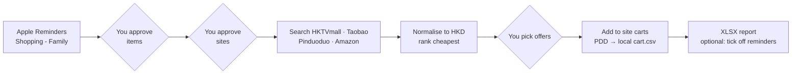

# Family Shopping Price Comparer

Reads your Apple Reminders list **"Shopping - Family"**. You approve which items get checked. The tool then compares prices on **HKTVmall, Taobao, Pinduoduo and Amazon** in HKD, and adds only the offers you pick to each site's cart. **It never checks out.**



## Setup (macOS)

The tool reads Reminders through `osascript`, so it has to run on a Mac that syncs the shared list.

```bash
python3 -m venv .venv && source .venv/bin/activate
pip install -r requirements.txt
python -m playwright install chromium   # skip if Google Chrome is installed
python -m price_comparer --login        # log in to each site once; the session is saved locally
python -m price_comparer                # normal run
```

The first run brings up a macOS prompt asking to let your terminal control **Reminders**. Click Allow. If you missed it, go to System Settings › Privacy & Security › Automation.

## Tuning searches from Reminders

Add lines like these to a reminder's **notes** field:

```
zh: 洗衣液            # used on Taobao + Pinduoduo
amazon: tide pods 81 count
hktvmall: ariel 2L
```

## Options

| Flag | Purpose |
|---|---|
| `--list "Name"` | Use a different Reminders list |
| `--items-file f.txt` | Plain-text list (works on any OS) |
| `--sites hktvmall,amazon` | Limit which sites are searched |
| `--amazon-domain amazon.co.jp` | Amazon marketplace (default amazon.com) |
| `--results 5` | Results per site per item |
| `--live-fx` | Live FX rates (default: built-in fallback rates) |
| `--headless` | Hide the browser (needs saved logins) |

Outputs go to `~/.price-comparer/`: `reports/comparison-*.xlsx` (comparison + cart sheets) and `cart.csv`.

## Site notes

| Site | Language | Cart | Notes |
|---|---|---|---|
| HKTVmall | English (`/hktv/en/`) | ✓ | |
| Taobao | English queries work, but `zh:` terms match far more | ✓ | Login required to search. If a size or colour picker appears, finish that step in the browser. |
| Pinduoduo | **No English version** | **✗ (PDD has no cart)** | Compared through mobile web. Picks are saved to `cart.csv` for you to buy in the app. |
| Amazon | English | ✓ | Set the delivery location to Hong Kong so prices and shipping are right. |

Product pages are found from link patterns, not fixed CSS classes. If a site redesign breaks extraction, edit `product_link` / `cart_buttons` in `price_comparer/sites/*.py`.

## Tests

```bash
pip install pytest && python -m pytest -q
```
