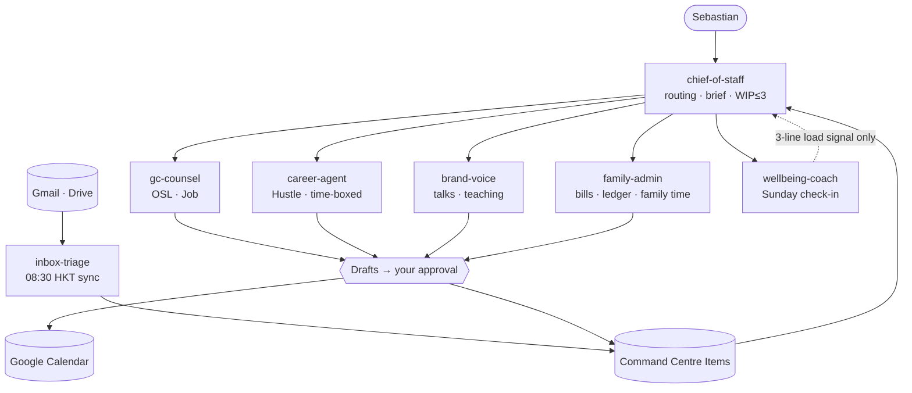

# 0xlawyoor — Life OS

Seven Claude Code subagents running on the existing Notion Second Brain. No new databases.

## Cadence
| When | Command | Agent |
|---|---|---|
| Weekdays ~08:13 HKT (scheduled) | `sync` then `morning brief` + approval table | inbox-triage → chief-of-staff |
| Two fixed weekly blocks | `career block` | career-agent |
| Sunday ~18:41 HKT (scheduled) | `weekly check-in` → `weekly review` | wellbeing-coach → chief-of-staff |
| Monthly | `ledger review` | family-admin |
| Quarterly | `refresh regulatory tracker` | brand-voice |

Rules: see `CLAUDE.md`.
